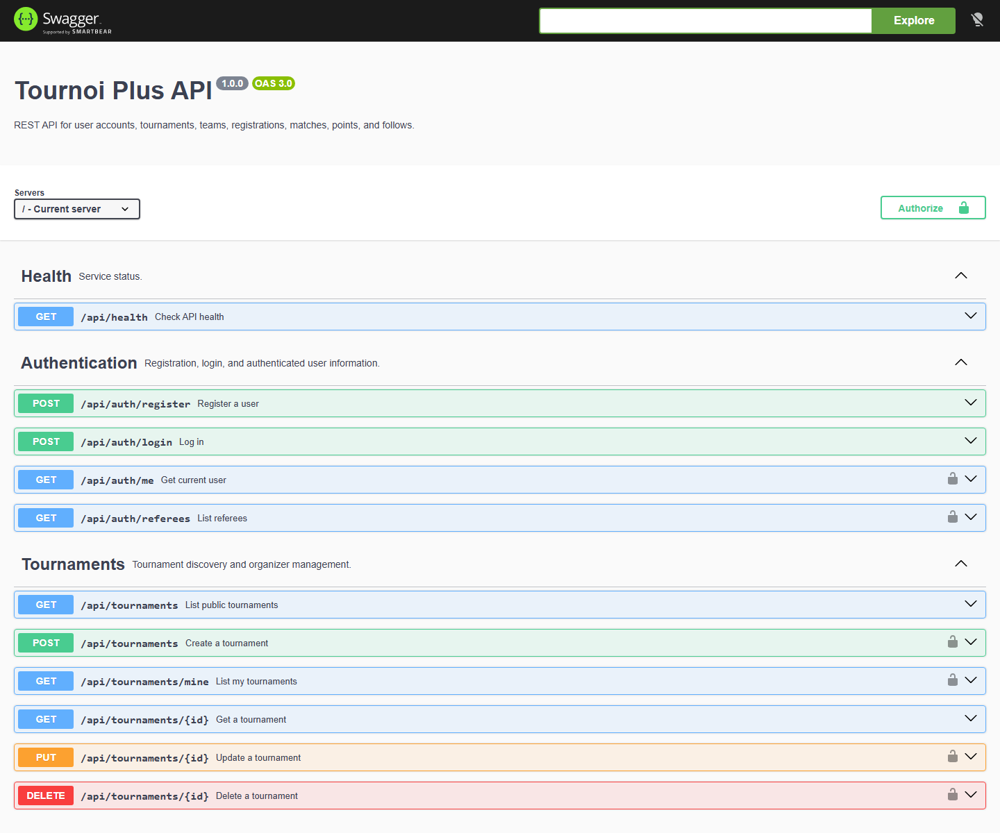

# Tournoi Plus

Application web de gestion sportive développée avec Angular. Elle permet de créer des tournois, gérer les équipes et les matchs, attribuer des points aux joueurs, suivre les compétitions et proposer une interface adaptée à chaque rôle utilisateur.

## Fonctionnalités

### Compte utilisateur

- Inscription avec nom, adresse e-mail, mot de passe et rôle.
- Connexion et déconnexion.
- Quatre rôles disponibles : organisateur, joueur, arbitre et spectateur.
- Protection de la route `/gestion` pour les utilisateurs non connectés.

### Espace organisateur

- Création, modification et suppression de tournois.
- Configuration du sport, des dates, du lieu, des règles, du format, du statut et du nombre d'équipes.
- Création et gestion des équipes.
- Gestion des demandes d'inscription des joueurs.
- Création, modification et suppression des matchs.
- Affectation d'un arbitre à un match.
- Tableau de bord avec statistiques sur les tournois, les équipes, les matchs et les inscriptions.
- Saisie des scores et des points des joueurs.

Formats de tournoi pris en charge :

- Élimination directe
- Championnat
- Phase de groupes

Sports proposés :

- Basketball
- Football
- Volleyball
- Handball

### Espace joueur

- Consultation des équipes disponibles.
- Envoi de demandes d'inscription.
- Suivi du statut des demandes : en attente, approuvée ou refusée.
- Consultation des équipes rejointes.
- Consultation des matchs associés.
- Suivi des points personnels.

### Espace arbitre

- Consultation des matchs qui lui sont affectés.
- Affichage du calendrier, des équipes, du lieu et du statut des rencontres.
- Consultation des scores enregistrés.

### Espace spectateur

- Recherche et filtrage des tournois.
- Filtres par nom, ville, date et sport.
- Suivi ou arrêt du suivi d'un tournoi.
- Consultation des tournois suivis et des matchs en direct.

## Architecture

```text
.
├── README.md
├── docker-compose.yml
├── .env.example
├── frontend/
│   ├── Dockerfile
│   ├── nginx.conf
│   ├── angular.json
│   ├── package.json
│   ├── src/
│   └── public/
├── backend/
│   ├── Dockerfile
│   ├── src/
│   │   ├── app.js
│   │   ├── database.js
│   │   └── routes/
│   └── test/
├── docs/
│   └── swagger-ui.png
├── rapport/
└── presentation/
```

## Travail réalisé pour cette remise

- Réorganisation du code Angular et de ses manifests dans `frontend/`; l’ancien scaffold React/Vite a été retiré pour ne garder que le frontend Angular du projet.
- Authentification Angular branchée sur l’API Express : inscription/connexion REST, JWT conservé dans `sessionStorage` et intercepteur pour les requêtes protégées.
- Ajout de l’écran organisateur `/gestion/tournois-api` qui permet le CRUD PostgreSQL des tournois et équipes. Les autres espaces historiques restent en stockage navigateur et ne sont pas encore synchronisés avec l’API.
- Documentation OpenAPI 3 complète des routes de l’API, interface Swagger UI, endpoint JSON et capture d’écran dans `docs/swagger-ui.png`.
- Ajout des Dockerfiles frontend (Angular puis Nginx) et backend, d’un Compose racine avec PostgreSQL et contrôles de santé, ainsi que `.env.example` sans secret réel.
- Ajout des dossiers et guides techniques demandés. `rapport/` et `presentation/` sont des emplacements à compléter avec les livrables personnels.

Les principales décisions et limites sont détaillées dans [docs/architecture.md](docs/architecture.md), les commandes et le dépannage dans [docs/developpement.md](docs/developpement.md), et la checklist de dépôt/soutenance dans [docs/livrables-github.md](docs/livrables-github.md).

Composants principaux :

- `Auth` : connexion et inscription.
- `Dashboard` : navigation selon le rôle connecté.
- `OrganizerSpace` : gestion des tournois et des compétitions.
- `PlayerSpace` : inscriptions aux équipes et suivi des matchs.
- `RefereeSpace` : consultation des rencontres affectées.
- `SpectatorSpace` : découverte et suivi des tournois.
- `Auth` service : gestion des comptes et de la session.
- `TournamentService` : gestion des tournois, équipes, demandes, matchs, scores, points et suivis.

## Stockage des données

L’authentification Angular et l’écran **Gestion des tournois (API)** utilisent l’API REST. Les comptes, tournois et équipes créés depuis cet écran sont persistés dans PostgreSQL. L’écran est accessible aux organisateurs depuis la navigation du tableau de bord.

| Clé | Contenu |
| --- | --- |
| `sessionStorage: gestion-tournoi-session` | Utilisateur connecté |
| `sessionStorage: gestion-tournoi-token` | Jeton JWT de session |
| `gestion-tournoi-tournaments` | Données des espaces de compétition existants |
| `gestion-tournoi-competition` | Équipes, demandes, matchs, scores, points et suivis des espaces existants |

Les espaces de compétition existants conservent leurs données dans le navigateur; l’écran de gestion API utilise les données PostgreSQL et les partage entre les appareils.

## Technologies utilisées

- Angular 21
- TypeScript 5.9
- Angular Reactive Forms
- Angular Router
- Angular HttpClient et intercepteur JWT
- RxJS
- Angular Signals
- Express, OpenAPI et Swagger UI
- Docker Compose, Nginx et PostgreSQL
- Vitest
- jsdom
- CSS
- Node.js, Express et PostgreSQL (API)
- bcryptjs et JWT (authentification de l’API)

## Principes Angular

- Création d'une application Angular avec composants autonomes.
- Structuration d'une application par fonctionnalités et services.
- Composant réutilisable `TournamentList` avec communication `@Input` / `@Output`.
- Pipe personnalisé `tournamentStatus`.
- Services injectables utilisant `HttpClient`, ainsi que Signals pour l’état.
- Routage avec paramètre `:tournamentId` et guards d’authentification/rôle.
- Gestion des formulaires réactifs et de leurs validations.
- Validateur personnalisé pour vérifier l’ordre des dates.
- Intercepteur JWT pour les requêtes protégées.
- Gestion des rôles et affichage dynamique des espaces.
- Modélisation de données pour les tournois, équipes, matchs et utilisateurs.
- Tests unitaires des services, composants et espaces utilisateur.
- Construction d'une interface responsive avec plusieurs thèmes visuels.

## Utilisation des compétences Copilot

Pour ce README et les développements associés, aucune compétence spécialisée externe n'a été chargée. Le travail a été réalisé directement avec les outils du projet, l'analyse des composants Angular, des services, des routes, des tests et de la configuration `package.json`.

Les outils et notions utilisés sont principalement :

- Angular CLI
- TypeScript
- Reactive Forms
- Angular Router
- Angular Signals
- Tests Vitest
- Analyse et rédaction technique

## Prérequis

- Node.js 20 ou plus récent
- npm
- Docker Desktop démarré
- L’extension VS Code **Container Tools** de Microsoft est facultative.

## Lancement complet avec Docker

```powershell
Copy-Item .env.example .env
```

Dans `.env`, remplacez `POSTGRES_PASSWORD` et `JWT_SECRET` par deux valeurs hexadécimales aléatoires (32 octets chacune). Vous pouvez en générer une avec `node -e "console.log(require('node:crypto').randomBytes(32).toString('hex'))"`. Puis lancez à la racine du dépôt :

```powershell
docker compose up --build
```

Le frontend Angular est servi par Nginx et l’API attend que PostgreSQL soit prêt. Accès :

| Service | URL |
| --- | --- |
| Application Angular | `http://localhost:4200` |
| Swagger UI | `http://localhost:3000/swagger/` |
| API REST | `http://localhost:3000/api` |
| Santé de l’API | `http://localhost:3000/api/health` |

La connexion et l’inscription sont disponibles sur `/login`. Après authentification, l’application redirige vers `/gestion`. Les organisateurs peuvent ouvrir la gestion PostgreSQL depuis le menu latéral.

Pour arrêter les conteneurs, utilisez `Ctrl+C` ou `docker compose down`. Le volume `postgres-data` conserve les données.

## API REST et Swagger

L’API Express documente ses endpoints dans OpenAPI 3 et sert Swagger UI sur `/swagger/`. Les routes protégées utilisent `Authorization: Bearer <token>`. Les mots de passe sont hachés avec bcrypt et les jetons JWT expirent après un jour par défaut. Les tables PostgreSQL sont créées au démarrage de l’API.

La documentation couvre l’authentification, les tournois, les équipes, les demandes d’inscription, les matchs, les scores, les points et les suivis.



### Endpoints principaux

| Méthode | Endpoint | Accès |
| --- | --- | --- |
| `POST` | `/api/auth/register`, `/api/auth/login` | Public, limité en fréquence |
| `GET` | `/api/auth/me`, `/api/auth/referees` | Connecté / organisateur |
| `GET`, `POST` | `/api/tournaments` | Public / organisateur |
| `GET` | `/api/tournaments/mine` | Organisateur |
| `PUT`, `DELETE` | `/api/tournaments/:id` | Propriétaire organisateur |
| `GET`, `POST` | `/api/tournaments/:id/teams` | Propriétaire organisateur |
| `PUT`, `DELETE` | `/api/tournaments/teams/:teamId` | Propriétaire organisateur |
| `GET`, `POST` | `/api/teams/directory`, `/api/teams/:id/join-requests` | Joueur |
| `GET`, `PATCH` | `/api/tournaments/:id/join-requests`, `/api/join-requests/:id` | Organisateur |
| `GET`, `POST` | `/api/tournaments/:id/matches` | Organisateur |
| `GET`, `PUT`, `PATCH`, `DELETE` | `/api/matches/:id` et sous-routes | Selon rôle |
| `GET`, `PUT` | `/api/follows`, `/api/tournaments/:id/follow` | Spectateur |

En développement hors Docker, Angular proxyfie `/api` vers `http://localhost:3000` via `frontend/proxy.conf.json`. Copiez les deux exemples de configuration, renseignez les mêmes identifiants PostgreSQL dans les deux fichiers et définissez un `JWT_SECRET` d’au moins 32 caractères dans `backend/.env`. Démarrez ensuite la base depuis la racine :

```powershell
Copy-Item .env.example .env
Copy-Item backend\.env.example backend\.env
docker compose up -d db
```

Dans un deuxième terminal, démarrez l’API :

```powershell
Set-Location backend
npm ci
npm start
```

Dans un troisième terminal, démarrez Angular :

```powershell
Set-Location frontend
npm ci
npm start
```

Les tests backend nécessitent PostgreSQL. Après le démarrage de la base, lancez `npm test` depuis `backend`.

## Construction

```powershell
Set-Location frontend
npm run build
```

Les fichiers de production sont générés dans `frontend/dist/`.

## Tests

```powershell
Set-Location frontend
npm test
```

Les tests frontend couvrent notamment :

- Application principale
- Authentification
- Guard de connexion
- Tableau de bord
- Service des tournois
- Client REST des tournois et équipes
- Espace organisateur
- Espace arbitre
- Espace spectateur

Les tests backend utilisent PostgreSQL. Démarrez la base avec `docker compose up -d db`, puis lancez `npm test` depuis `backend`.

## Routes

| Route | Composant | Accès |
| --- | --- | --- |
| `/` | Redirection vers `/login` | Public |
| `/login` | Authentification | Public |
| `/gestion` | Tableau de bord selon le rôle | Utilisateur connecté |
| `/gestion/tournois-api` | CRUD PostgreSQL des tournois et équipes | Organisateur connecté |
| `/gestion/tournois-api/:tournamentId` | Sélection d’un tournoi et gestion de ses équipes | Organisateur connecté |
| Toute autre route | Redirection vers `/login` | Public |

## Améliorations possibles

- Ajouter les notifications et mises à jour en temps réel.
- Mettre en place des rôles administratifs plus fins.
- Ajouter un tableau de classement automatique.
- Exporter les résultats et calendriers.
- Déployer l'application sur une plateforme d'hébergement.
